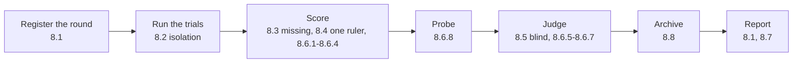
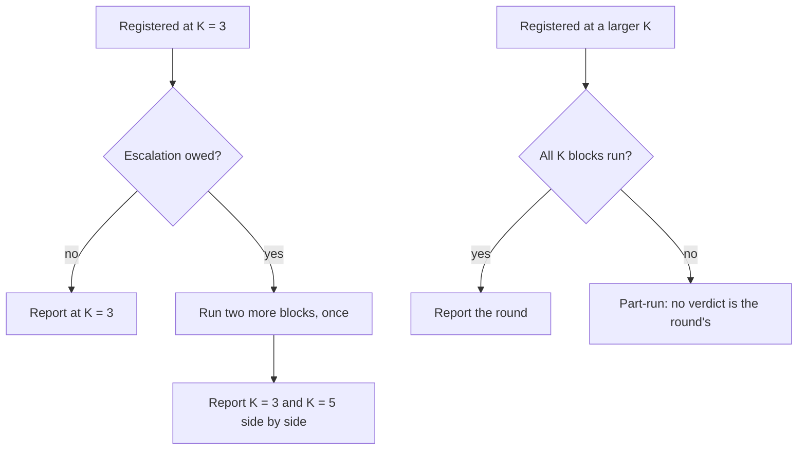
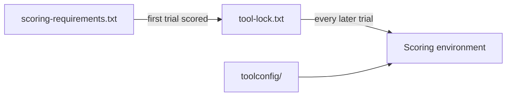
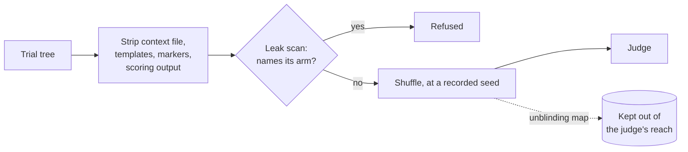
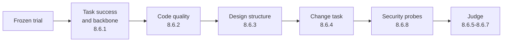
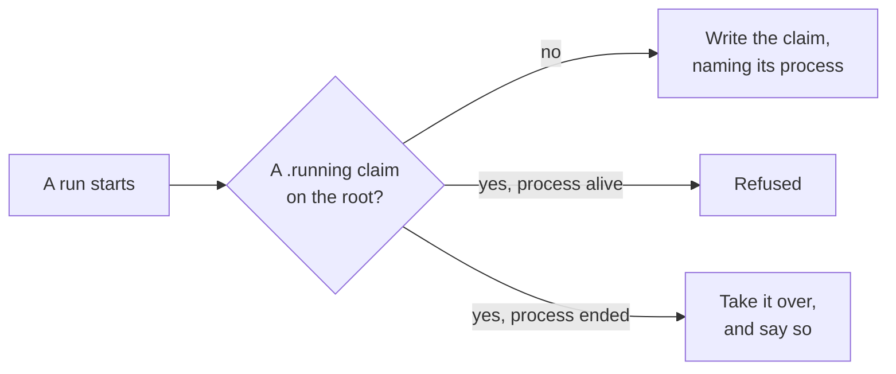

# 8. Crosscutting concepts

The rules that more than one script follows, and why each exists.

- Each rule has an ID and a check behind it in the
  [requirements](../requirements.md). This chapter gives the reasons.
- A round's registration under `docs/rounds/` can add rules or tighten these.
  Round 5d, for example, registers its own verdict rules and radar.
- Some rules start at a given round. Earlier rounds re-read the way they were
  reported, so the report keeps their old rules too.

Where each concept acts on a trial:



## 8.1 The registered rules

Every rule for reading a result is fixed before the first trial. Nobody can
then choose a metric or a threshold after seeing the numbers.

### 8.1.1 Rules, fixed before the first run

**A round's registration comes before its first trial.** From round 5 on, the
report refuses a round when:

- its registration landed on `main` after the first trial started
  - it reads `main`'s first-parent line, so a merge counts at the merge
- its registration differs from `main`'s copy, or has uncommitted changes
- a trial built from a spec or prompt other than the registered one, by
  content
- a trial with something to score records no spec or no prompt

The harness checks the spec before every trial too. An edit made mid-run
refuses the trials after it, instead of building them.

Two details keep the order honest on any machine:

- A trial records its start with its UTC offset. A start with no offset is
  refused, not guessed.
- Registrations land through a pull request's squash or rebase merge. A
  fast-forward pushed from a clone keeps its branch commit's older date.

**How a result is read.**

| Step | Rule |
|---|---|
| Unit | One block's difference between two arms, such as `hand-1` minus `none-1`. Arms in a block meet the same model on the same day |
| Result | The mean of the K differences, per metric and contrast |
| Interval | 95 % bias-corrected and accelerated bootstrap over the K differences, 10,000 resamples, seed recorded |
| Direction | Declared per metric (8.7.2), since half the metrics improve downward |

The verdict depends only on where the interval sits against zero:

```text
                   worse side   0   improving side
                                |
  Better                        |   [=======]        wholly on the improving side
  Worse          [=======]      |                    wholly on the worse side
  No improvement           [====|====]               contains zero
  shown
```

"No improvement shown" does not mean "equal". Claiming that needs 8.1.2.

### 8.1.2 Rules for claiming "nothing got worse"

A trim shortens the templates. It may claim a metric **held** only when the
whole interval of the change lies inside the margin: the largest loss the
round tolerates.

```text
                 -margin            0
                    |               |
  Held              |   [=======]   |      whole interval above -margin
  Not shown held  [=|=====]         |      reaches past the margin
```

| Metric | Unit | Margin | Smallest change that matters | Since |
|---|---|---|---|---|
| Hidden-test pass rate | pp | 2 | 5 | round 1 |
| Adherence checklist | pp | 5 | 10 | round 1 |
| Primary judge scores, 1–5 | points | 0.3 | 0.5 | round 1 |
| Static-analysis counts per 1,000 lines | relative % | 10 | 25 | round 1 |
| Change-task churn, files and lines | relative % | 15 | 30 | round 1 |
| Security probe pass rate | pp | 2 | 9 | round 3 |
| Data-protection probe pass rate | pp | 10 | 30 | round 3 |
| App code, lines and files | relative % | 20 | 40 | round 5 |

- An adherence gain counts only if the pass rate held. Following rules while
  breaking the app is no improvement.
- A trim is free only if every metric held.
- The report shows every metric. Its summary score decides nothing.
- Round 5 holds adherence within 8 pp, one checklist item of 13, as
  [its registration](../rounds/round-5.md) states.

This is a non-inferiority test, the kind drug trials use to show a new
treatment is no worse than the standard by more than a set margin. Below
K = 6 it describes the result and proves nothing.

### 8.1.3 Few trials, and the one escalation

**Three trials describe; they do not prove.** Three differences give the
bootstrap only 27 distinct resamples, and no arrangement of three reaches
conventional significance. The report says so beside every interval.

A round sizes K one of two ways:



- **Owed** where a primary's interval contains zero while its mean exceeds
  the smallest change that matters (8.1.2).
- A result still unsettled at K = 5 is reported as inconclusive.
- Any contrast can owe it, for an effect in either direction. The report
  computes whether it is owed.
- A larger K is sized before the first trial, from earlier rounds' noise.
- K never exceeds 5 under escalation. Sampling until an interval clears zero
  is the failure this bound prevents.
- A round with a larger K adds no block once results are seen. Round 5
  registers K = 15 ([its registration](../rounds/round-5.md), 13.5).

### 8.1.4 Failed and lost trials

A **failed** trial is the agent's doing. A **lost** trial is the provider's.

| How the trial ended | Kind | What happens |
|---|---|---|
| Completed | — | Scored |
| Budget cap or timeout | Bound (ch. [6.1](06-runtime-view.md)) | Scored as it stands |
| No installable workspace | Failed | Task success 0, quality metrics missing, never re-run |
| Usage limit, rate limit, crash, or no result | Lost | Re-run once, in its own place in the order |
| Lost a second time | Lost | The run stops |

- Re-running one arm's failures would quietly improve that arm.
- A lost trial's partial workspace is kept under the run's `void/` directory
  and never scored.

## 8.2 Isolation in layers

No single fence stops every route out of a workspace. The harness stacks
several and records what each caught.

| Layer | Stops | Cannot stop |
|---|---|---|
| Scratch home, minimal settings | The owner's global `CLAUDE.md`, hooks, memory and MCP | |
| Cleaned environment | The launching session's variables, interpreter and keys | |
| Deny rules on file tools | Read and Edit outside the trial's workspace | The shell, whose paths a prefix rule cannot see |
| Web tools disallowed | Fetching a page | `curl` or `git clone` in the shell |
| Git credential helpers cleared | An authenticated clone of the hidden suite | |
| Process-stop commands denied | Stopping the harness by name | Stopping by PID or port |
| Transcript scan | Any tool call naming a forbidden path or repository | A call the transcript does not record |

The transcript scan is the backstop. A hit voids the trial and re-runs it
once, and the report scans again under the current rule.

## 8.3 Missing is not zero

A zero has to mean "measured, and none found". So:

| Case | Recorded as |
|---|---|
| A tool scanned nothing, failed or timed out | Missing, with the reason |
| A grader skipped a check | Not passed |
| The trial keeps a probe from running | Lost: the probe fails |
| The harness could not run a probe | The rate is missing |

Each script's self-test plants these cases and fails if one reads as zero.

## 8.4 One ruler

Every trial is measured with the same tool versions.



- The lock leaves out anything local, editable, or named like the package
  under score, so one trial's code never installs over another's.
- `toolconfig/` is the only configuration the tools run under.
- Every build is scored on the spec's Python. The report refuses a round
  whose scores ran on two.

## 8.5 Blindness

The judge must not know which arm wrote a tree.



## 8.6 Scoring

Each frozen trial goes through the same pipeline. The deterministic stages
run on every trial; the judge comes last.



### 8.6.1 Task success and the backbone

**Task success** is the hidden suite's pass rate. The suite lives in a
private repository. It is cloned only at scoring time, never into a
workspace. It covers:

- the Python API: rule precedence, stacking, tier boundaries, rounding to
  the cent, jurisdiction tables, invalid rules refused
- every route through the Flask test client, including HTMX fragments that
  re-price correctly
- the JSON and CSV exports, byte-exact against the seed
- forms with JavaScript disabled, and browser flows through Playwright

The rest of the backbone:

| Measure | What it reads |
|---|---|
| Install | `pip install .` in a clean virtualenv, `import tariff`, and the app serves `/` |
| Accessibility | axe-core WCAG 2.1 AA violations |
| HTML validity | Errors, less those on HTMX's `hx-*` attributes, which the spec requires and HTML lacks |
| XSS and CSRF | One probe each |
| Invoice builder | Response size and request count |
| Adherence | Share of a fixed checklist of 13 items passed |
| Cost | Tokens, turns, wall time, API-equivalent dollars |
| Scope | Files and lines, and artifacts nobody asked for: ADR, journal, CHANGELOG, PLAYBOOK |
| Consistency | Each metric's spread across an arm's trials |

The adherence checklist:

- **Tools:** `ruff` clean, `ruff format` clean, `mypy --strict` clean,
  coverage ≥ 80 %, cognitive complexity ≤ 15.
- **Structure:** a `src/` layout, one error hierarchy, a `NullHandler`.
- **Hygiene:** no `print` in library code, no citations.
- **Packaging:** complete metadata, a README with install and usage,
  discoverable tests.

It checks quality, not the templates, so the bare arm can score on it too.

### 8.6.2 Code quality

The tools run at the harness's pinned versions and configuration, never the
configuration the agent wrote. Counts are reported absolute and per 1,000
lines.

| Tool | Measures |
|---|---|
| `ruff check --select ALL` | Violations, by category |
| `ruff format --check` | Files needing reformatting |
| `mypy --strict` | Type errors |
| `bandit` | Security findings, high and medium |
| `complexipy` | Cognitive complexity: max, mean, functions over 15 |
| `radon` | Cyclomatic complexity, maintainability index |
| `interrogate` | Docstring coverage |
| `vulture` | Unused code |
| `pytest --cov` | Line and branch coverage of the agent's own tests |

Not measured: mutation score, class cohesion, pylint's refactoring checks.

**Finding the code.** Each arm picks its own layout, so the tools never
assume `src/`. A tool pointed at an empty `src/` would report zero findings,
and zero must never mean "nothing scanned". The harness:

1. imports the installed package and takes its directory
2. adds every top-level package directory in the workspace
3. passes those paths to every tool explicitly

The report shows how many files and lines each tool saw, so a clean arm can
be told from an unmeasured one.

**Coverage installs the test dependencies.** The clean install leaves out a
trial's extras and dependency groups. Without them a suite fails on an
import, and a trial that packaged its tests correctly would read as
unmeasured. So the coverage run first installs every extra and dependency
group in `pyproject.toml`, within the tool lock. One that conflicts with the
lock records coverage as missing, with the conflict as the reason.

### 8.6.3 Design structure

The harness probes each tree's structure directly.

| Probe | Asks |
|---|---|
| Layering | Does the domain import neither Flask nor persistence? Do routes do no `Decimal` arithmetic? |
| Import graph | Mutual imports, and the domain modules' mean instability (Martin), through `grimp` |
| Extension points | Can a discount kind, a jurisdiction or an export format be added without editing existing code? Per axis |
| Kind ladders | Conditionals that dispatch on a rule's kind |
| Boolean parameters | Branches the caller cannot name |
| Public surface | Names exported against names the spec requires |
| IO isolation | Does pricing take values, not rows or a connection? |
| Hygiene | `print` calls, exception bases, citations, a `NullHandler` |

### 8.6.4 The change task: the open-closed measure

The change task measures how well a build takes a change it was not built
for. It must lie outside what the spec allows, or it measures data entry,
not design. It adds two things no configuration reaches:

| Addition | Why configuration cannot reach it |
|---|---|
| Spend-threshold discount: 5 % off once the subtotal reaches 200.00, before coupons | The first rule gated by a condition over the invoice. Every other kind is unconditional or gated by a coupon |
| Capped reduced rate: one category taxed at the reduced rate on a line's first 50.00, the standard rate above | The first tax that is not one rate times one amount. It changes the tax step's shape, not its inputs |

Measured:

- files touched and lines changed
- whether the build suite is still green
- whether the change-task acceptance modules pass, through the API
- from round 3, whether the new rule and cap work through the forms and the
  invoice preview

A new rule class plus a registry entry scores low churn. Editing the
pricing function, the tax step, three routes and two templates scores high.
Churn means something only beside a pass: an arm that touched four lines and
broke the extension has not scored well.

Two rules keep the grading fair:

- **The prompt states everything the grader drives:** the new class, the
  cap's keyword, the form fields, the rules the acceptance modules check.
  Round 1's grader used names the prompt never gave, so it graded guessing,
  and its pass rate was withdrawn (8.7.5).
- **The acceptance modules are written before any change-task run.** They
  test the two behaviours against worked figures.

### 8.6.5 Pattern use

For each design pattern it finds, the judge records where it is, what it
removes or opens, and whether it has more than one implementation.

| Kind | What counts |
|---|---|
| Warranted | Patterns the app invites: Strategy for discount kinds, a registry or Factory to resolve a rule or jurisdiction by name, Composite or a precedence chain for stacking, Adapter for exports, Builder for an invoice |
| Missed | A conditional ladder over rule kinds where a Strategy was warranted |
| Over-engineered | A pattern with one implementation that removes nothing, per `oop.md` |

It scores the property, not the name. A design that reaches the same
extension points another way scores the same.

### 8.6.6 The model judge

**The rubric.** Each row is scored 1–5 with a quoted evidence line:

- SOLID: SRP, OCP, LSP, ISP, DIP
- naming and abstraction level, error design
- readability, maintainability, test quality
- security, data protection

**Primary dimensions** lead the report, before task success and cost:
design (SOLID and pattern use), readability, maintainability, and from
round 3 security and data protection (8.6.8).

**How it judges:**

| Rule | Why |
|---|---|
| Anchored: each primary describes its 1, 3 and 5 in this domain's terms | A scale saying only "1 is poor, 5 is excellent" put 3 on ordinary work every time |
| Three judgings per tree, averaged | One judging is not reproducible |
| Blind (8.5) | The judge must not favour an arm it can name |
| Model and effort recorded with every judging | A reading is tied to the judge that made it |
| Read-only: it may read the bundle and do nothing else | A judge that edits or runs the code changes what it scores |

**Which judge.** From round 5, `gpt-6-astra` through `codex exec` at effort
`high` judges every trial, and no cross-check runs
([round 5's registration, 13.1](../rounds/round-5.md)).

Earlier rounds used `claude-opus-5-5` through the `claude` CLI at effort
`high`. It shares a vendor with the generator. Every arm has the same
generator, so a contrast cancels most of that bias, but not a preference for
the templates' style, which was largely written with Claude. So `gpt-6-astra`
cross-checked a sample of each round, under a rule registered before the
first round it covered:

- **Sample:** whole blocks, so every contrast it reads is paired. Every
  build trial once where the plan's weekly limit allows; otherwise blocks
  drawn in a shuffled order at the round's seed until the limit.
- **Agreement:** per row, the mean difference between the two judges, and
  the share of trials whose scores lie within one point.
- **Direction:** a better or worse verdict loses it when the other judge's
  mean paired difference has the opposite sign. Zero or unread keeps it.
- **Never mixed:** the other judge's scores never replace or join the main
  judge's, and its intervals decide nothing.

### 8.6.7 How the judge is checked

No person scores the judge. Two automated checks do.

**The evidence check.** Every line the judge quotes is looked up in the
bundle it came from. The report prints the share found per trial. A judge
that never opened the code still returns plausible numbers; this check tells
the two apart.

**The control fixture.** Trees built from two pinned applications, in
`tests/efficacy/control/`. Each tree changes one thing and passes the same
tests as its application. A primary counts only if it falls on the tree that
damages it and rises on the one that improves it, under the rounds' judge.

| Reading | What it means |
|---|---|
| Falls on its damaged tree, rises on its improved one | The row works |
| Does not fall | It cannot detect damage |
| Does not rise | It cannot detect improvement, so no arm can win on it |
| Moves on neither | It carries no information |

#### The control's trees

The first application is a round-1 tree with no sign-in and no customers, so
it cannot move the security or data-protection rows. The second is one
uncounted calibration trial: an ordinary build of the extended spec by the
rounds' generator. The reference implementation cannot serve instead: it is
a worked answer to the hidden suite and stays private.

Each tree is built to move one row. Read a row against its own tree; the
others check that it is not moving on noise.

| Tree | Built to move | What it changes |
|---|---|---|
| `base-1` | — | The first application, unaltered |
| `degraded-1` | design ↓, maintainability ↓ | Domain merged into one module, `from flask import current_app` inside `price`, the exceptions reparented off `TariffError` |
| `obscured-1` | readability ↓ | Pricing inlined into one long function with abbreviated names; nothing else |
| `clarified-1` | readability ↑ | Pricing rewritten into short one-step functions with names that carry the intent; nothing else |
| `improved-1` | design ↑, maintainability ↑ | A rule contract and self-registering kind registry; type dispatch removed from pricing, persistence and a template; stray errors folded into the hierarchy |
| `improved-2` | design ↑, maintainability ↑ | `improved-1`, and the store maps a rule's terms onto columns with a codec per column, so no module dispatches on a kind |
| `improved-3` | design ↑, maintainability ↑ | `improved-2`, and each kind declares its form fields, so forms and template derive from the registry |
| `base-2` | — | The calibration trial, unaltered: guarded routes, CSRF tokens, a salted hash, local-only `next`, a generated secret key; erasure clears the fields; nothing logged |
| `insecure-1` | security ↓ | Literal secret key, plaintext password, a lookup built from a string, `next` followed anywhere |
| `secured-1` | security ↑ | Secret key from the environment, `HttpOnly` and `SameSite` cookies, three security headers, `next` checked by a named function that also refuses a backslash |
| `leaky-1` | data protection ↓ | Name, email and address logged on creation and erasure; erasure only raises a flag |
| `protected-1` | data protection ↑ | One tuple names the personal fields for erasure and export; one lookup hides an erased customer; SQLite overwrites what it deletes |

The damage in `insecure-1` and `leaky-1` sits where the hidden suite does not
look: it does not grade password storage, cookie flags or an off-site
`next`, and it reads erasure through the pages.

<!-- measured: 2026-09-25 -->
Each tree's hidden-suite result is identical, test by test, to `base-2`'s,
at suite revision `65bfb9a`: 293 of 534 pass. The
calibration trial seeds only through its command, not when the application
opens an empty database as the specification asks, so the suite's
administrator does not exist and 240 checks behind sign-in fail on every tree
alike. That comparison therefore covers the 293 that pass, the pricing and API
checks among them.
<!-- /measured -->

**The builder proves its own changes.** It prints one line per entity it
claims to change, read back off the built trees, and refuses when a mutation
did not land. A mutation that silently did nothing would read as the judge
holding when it was never tested.

**When to re-run it.** Whenever the judge model, its effort, or the rubric
prompt changes. Each change silently invalidates every earlier reading. The
measured results are in [validation](../validation.md).

#### Why the bases are pinned archives

`base.zip` and `base-2.zip` each hold one trial's output. They are inputs to
the control, not artifacts of it: a regenerated base would compare a later
run against a different application. `base-2.zip` is `git archive` of the
calibration trial's commit `f74c0cc`, which reproduces it byte for byte.

Two guards hold them still:

- The builder refuses an archive whose sha256 is not the one in `control.py`.
- Every edit is an exact-text swap that refuses when its target is absent, so
  a drifted base stops the control instead of mutating less than it claims.

They are archives, not directories, because this repository's linters would
read committed Python as source to fix. Reformatting the fixture would edit
the very thing the judge scores.

### 8.6.8 Security and data protection

From round 3, security and data protection are primary dimensions, each read
two ways:

| Metric | What it is | Direction | Margin | Smallest change that matters |
|---|---|---|---|---|
| `judge_security` | Anchored judge row, 1–5 | up | 0.3 points | 0.5 points |
| `judge_data_protection` | Anchored judge row, 1–5 | up | 0.3 points | 0.5 points |
| Security probe pass rate | Share of 11 probes passed | up | 2 pp | 9 pp |
| Data-protection probe pass rate | Share of 3 probes passed | up | 10 pp | 30 pp |

**The probes.**

| Security (11) | Data protection (3) |
|---|---|
| Plaintext password at rest | Sentinel customer email in the logs |
| Sign-in failures that reveal which accounts exist | An erased customer's sentinel still in the database file |
| Open redirect after sign-in | One customer's export carrying another's data |
| No CSRF on sign-in | |
| Hard-coded secret key | |
| Debug left on | |
| SQL assembled from a value not traceable to constants | |
| Known vulnerabilities in installed dependencies | |
| Missing session cookie flags | |
| Missing security headers | |
| Stack traces in answers to malformed requests | |

**How a probe reads the app.** It seeds and signs in the way the hidden
suite does: the administrator's password from the environment, then the
sign-in form's own fields. Where a probe needs a judgement, it takes the
narrow one:

| Probe | Reads | Why so narrow |
|---|---|---|
| Cookie flags | `HttpOnly` and `SameSite` | `Secure` cannot be observed over plain HTTP |
| Headers | `nosniff` and framing protection | No content security policy: the spec requires HTMX |
| Sentinel in logs | Counts at any level | A call that logs personal data does so whatever the level |
| Erased sentinel | Counts anywhere beside the database, free pages included | That is where erasure leaves it |

**A probe the trial keeps from running is lost.** An app that will not boot,
install or sign in its administrator fails every probe that needs it, with
the reason. Counted as missing, those probes would drop out of the rate, and
a trial would score higher for not reaching them. A probe the harness itself
could not run leaves the rate missing.

**How the probe margins are set.** Both follow one rule, so they change only
when a probe count does:

| | Security (11) | Data protection (3) |
|---|---|---|
| Margin: under one probe lost in one trial at K = 3 | under 3.0 pp → 2 | under 11.1 pp → 10 |
| Smallest change: one probe lost in every trial | 9.1 pp → 9 | 33.3 pp → 30 |

Before round 3's first trial, each row was anchored at 1, 3 and 5, and each
passed the control fixture (8.6.7). The last seven security probes were
declared after round 1, so they described that round and decided nothing
(8.7.4). Fixed before round 3, they decide it.

## 8.7 The report

### 8.7.1 Contrasts

Each metric is reported per arm and for the contrasts a round registers.
Round 5's:

| Contrast | Asks |
|---|---|
| `inline − none` | Does every rule, copied in, help? |
| `hybrid − none` | Does the hybrid model help? |
| `reference − none` | Does naming the templates help? |
| `skills − none` | Do a root file and task skills help? |
| `skills − hybrid` | H1: do skills deliver what hybrid does? |
| `reference − hybrid` | H3: does naming the templates alone deliver less? |
| `skills − inline` | The same rules, with and without the split into skills |

- A round that measures a template change registers one contrast,
  `candidate − baseline`, with both arms run in that round
  ([ch. 4.2](04-solution-strategy.md)).
- **Pairing trials from different rounds gives no verdict.** The contrast
  keeps its mean and interval, and counts as neither a win nor a fail.
- A round may instead register a contrast with an earlier round's arm as
  **unpaired**, read with an unpaired interval, as round 5d does.
- Earlier rounds' contrasts stay declared in `report.py`, so an old round
  re-reads as it was reported.

### 8.7.2 Metric directions

| Direction | Metrics |
|---|---|
| Better up | Task success, adherence, coverage, docstring coverage, extension points present, every judge score, the probe pass rates |
| Better down | Every static-analysis count, cognitive and cyclomatic complexity, tokens, turns, wall time, cost, files, lines, artifacts nobody asked for, change-task churn, axe violations, HTML errors |
| Down, against a band | From round 5, app code's lines and files. A rise wholly inside the margin (8.1.2) reads as held; only one wholly past it reads as worse |
| Neutral, no verdict | Maintainability index, instability, test code's lines; from round 5, the source lines and files app code replaces; before round 5, app code's rows |

### 8.7.3 What the report prints

A round writes three documents to `docs/audits/`, one per reader, plus the
radar's two images:

| File | Reader | Holds |
|---|---|---|
| `YYYY-MM-DD-efficacy.md` | Anyone deciding | The radars, each approach in plain words, the round's questions answered, how sure the answers are |
| `YYYY-MM-DD-efficacy-appendix.md` | Someone checking a claim | What produced the results, the radar's axes row by row, the verdict vector |
| `YYYY-MM-DD-efficacy-record.md` | An auditor | Every metric's table, the change task, raw numbers per trial, lost and re-run trials, reaches, the evidence check |

**The radar.** One per file arm, against `none` as the ring at 0. Its axes
group the verdict vector's rows, in a fixed order: reliability, security,
data protection, design, maintainability, tests, economy. An axis is the
share of its rows better than `none` minus the share worse, from −1 to +1. A
withheld or uncomputed verdict counts neither way. It comes as two SVGs,
light and dark, and GitHub shows the one matching the reader's theme. Round
5d registers a radar sized by how far each row moved instead.

**Each approach, in plain words.**

- What it did better and worse than `none`, by radar axis.
- Reliability: how many runs fell short, and how many would not start.
- Cost: dollars per run.
- Its verdict, from the deciding measures: the hidden tests, both probe
  sets, and the judge's five primaries.
  - **Yes:** one is better and none worse.
  - **Worse:** any is worse.
  - **No:** none moved.

The radar and the words describe the verdicts and decide nothing. Every
claim rests on a row of the appendix or the record.

### 8.7.4 Checks declared after a run

A check chosen after the results were seen can describe a run, never decide
it. Otherwise the bar moves with the results.

- It is declared in writing, with its direction, before any trial is read
  for it.
- The report prints it in its own section, with means and intervals and no
  verdict.
- It never enters the verdict vector, a "nothing got worse" claim, or the
  escalation.
- A check worth deciding on is fixed before the next run.

### 8.7.5 Withdrawn measurements

A metric whose grader turns out to measure something else is withdrawn, not
reported.

- The withdrawal goes in `tests/efficacy/withdrawn.json`, against the
  grader's revision.
- Every run that revision graded loses the metric. A run graded by a
  corrected revision keeps it.
- The report names the metric and the reason, with no number, interval or
  verdict.
- A corrected grader never re-grades the same trials. The correction is
  fixed before the next run.

## 8.8 Records

Every stage writes what it did beside what it made.

| Stage | Records |
|---|---|
| Harness | The run record, per invocation |
| Arm generator | `generation.json`, per generated file |
| Scoring | Each score with the revisions it was graded under |
| Judging | Each judging with its model, effort and seed |
| Archive | All of the above, carried to the private archive with a hash per file |

The report refuses to write once any reading changed since the archive was
verified.

## 8.9 One run at a time

`score.py`, `judge.py` and `security.py` each clear a trial's directory
before rebuilding it, so two runs on one root would destroy each other's
work.


