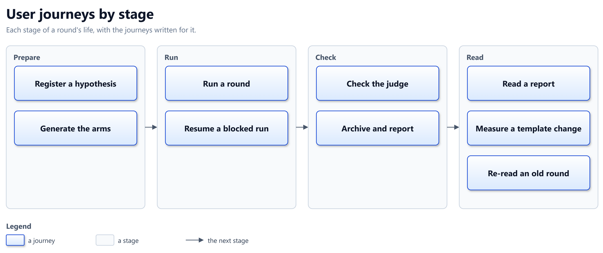

# User journeys

A journey walks one person through one task, step by step with the time
each takes, and ends with findings that become issues. Journeys are not
normative: the rules are in the
[architecture](../architecture/08-crosscutting-concepts.md). Each journey
carries the commands it runs.

They are grouped by the stage of a round's life. A round is prepared, run,
checked and read. Each figure is marked measured, with the round it came
from, or estimated.

## Prepare

| Journey | Role | Target |
| ------- | ---- | ------ |
| [Register a hypothesis](prepare/register-a-hypothesis.md) | Owner | A testable question registered before any trial runs |
| [Generate the arms](prepare/generate-the-arms.md) | Operator | Each generated arm's file made once, clean and within budget |

## Run

| Journey | Role | Target |
| ------- | ---- | ------ |
| [Run a round](run/run-a-round.md) | Operator | Every trial built, changed and scored, with none lost |
| [Resume a blocked run](run/resume-a-blocked-run.md) | Operator | A round finished after a usage limit, with no trial counted twice |

## Check

| Journey | Role | Target |
| ------- | ---- | ------ |
| [Check the judge](check/check-the-judge.md) | Owner | Proof that every primary judge row can move |
| [Archive and report](check/archive-and-report.md) | Operator | A verified archive, then the dated report |

## Read

| Journey | Role | Target |
| ------- | ---- | ------ |
| [Read a report](read/read-a-report.md) | Adopter with little technical background | A yes or no on adopting a generated file, in 15 minutes |
| [Measure a template change](read/measure-a-template-change.md) | Maintainer of a fork | Whether a trim is free |
| [Re-read an old round](read/re-read-an-old-round.md) | Owner | A second judge's reading of a finished round |

## Open findings

| Finding | Journey | Issue |
| ------- | ------- | ----- |
| Nothing checks that a hypothesis was committed before its round's first trial | [Register a hypothesis](prepare/register-a-hypothesis.md) | #14 |
| No CI runs the self tests | [Check the judge](check/check-the-judge.md) | #6 |
| No index of reports in this repository | [Read a report](read/read-a-report.md) | #17 |
| A candidate compared with an earlier round's baseline gets no verdict | [Measure a template change](read/measure-a-template-change.md) | #18 |

## Adding a journey

1. Copy [TEMPLATE.md](TEMPLATE.md) to `docs/journeys/<stage>/<topic>.md`.
   Open with a short paragraph naming one person with a role and a goal.
   Then list, one bullet each, the targets the journey tests under
   "Target:" and the assumptions under "Assumptions:".
2. Walk the steps as that person, with the time and cost of each. Mark each
   figure measured, with the round it came from, or estimated.
3. Check each finding against the architecture and the round registrations
   before calling it a gap. Name its kind:
   - a gap
   - missing coverage of what exists, in a command, a check or a chapter
   - a change to what exists
4. List the findings, each with the chapter, decision or issue that settles
   it, or "Open".
5. List the journey in this index and draw it in
   `docs/diagrams/journeys.drawio`. Settle each open finding in an issue.
